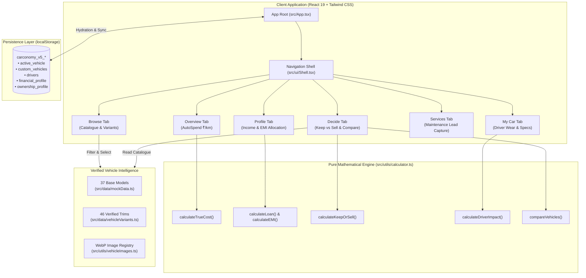

# CarConomy — Automotive Financial Intelligence

> **Know what your car really costs.** Real total cost of ownership (₹/km), depreciation curves, multi-driver wear modeling, and data-driven keep-or-sell decisions tailored for the Indian car market (₹5–25 Lakh segment).

[](https://react.dev/)
[](https://www.typescriptlang.org/)
[](https://vitejs.dev/)
[](https://tailwindcss.com/)
[](https://capacitorjs.com/)
[](#license-and-acknowledgements)

---

## Table of Contents

- [About CarConomy](#about-carconomy)
- [The Problem We Solve](#the-problem-we-solve)
- [Core Product Modules](#core-product-modules)
  - [1. AutoSpend (Ownership Cost Intelligence)](#1-autospend-ownership-cost-intelligence)
  - [2. ResaleOS (Keep vs. Sell Decision Engine)](#2-resaleos-keep-vs-sell-decision-engine)
  - [3. Vehicle & Trim Variant Explorer](#3-vehicle--trim-variant-explorer)
  - [4. Multi-Vehicle Comparison Engine](#4-multi-vehicle-comparison-engine)
  - [5. Household Affordability Tiering](#5-household-affordability-tiering)
- [Technology Stack](#technology-stack)
- [System Architecture](#system-architecture)
- [Directory Structure](#directory-structure)
- [Installation and Local Setup](#installation-and-local-setup)
- [Environment Variables](#environment-variables)
- [Verification & Testing](#verification--testing)
- [Deployment](#deployment)
  - [Vercel Deployment](#vercel-deployment)
  - [Android Mobile Build (Capacitor)](#android-mobile-build-capacitor)
- [Product Roadmap](#product-roadmap)
- [Contributing](#contributing)
- [License and Acknowledgements](#license-and-acknowledgements)

---

## About CarConomy

**CarConomy** is a client-side automotive financial intelligence platform designed for Indian middle-class and salaried households. While conventional automotive portals focus purely on initial ex-showroom prices or spec-sheet horsepower, CarConomy models the complete financial lifecycle of a vehicle:

$$\text{True Cost per Kilometre (₹/km)} = \frac{\text{Fuel} + \text{Loan Interest} + \text{Depreciation} + \text{Insurance} + \text{Maintenance} + \text{Wear}}{\text{Annual Kilometres}}$$

### The Philosophy

> **Buy Smarter. Own Smarter. Sell Smarter.**

1. **Before Buying:** Evaluate whether a car genuinely fits your household cash flow (`COMFORTABLE`, `STRETCHED`, or `AGGRESSIVE`) based on net monthly income and debt-to-income ratios—not just dealership loan eligibility.
2. **During Ownership:** Dissect real operating costs, track multi-driver wear impact, and simulate how aggressive driving or city traffic degrades efficiency.
3. **Before Selling:** Eliminate panic-selling and arbitrary upgrades with a deterministic break-even analysis that compares 12-month forward maintenance and depreciation of your existing car against the amortized cost of a replacement.

---

## The Problem We Solve

Indian car buyers face substantial hidden financial friction:

- **The Ex-Showroom Illusion:** A car listed at ₹10 Lakh typically costs ₹18–24 Lakh over 5 years once financing charges, RTO road taxes, comprehensive insurance, and maintenance are factored in.
- **Powertrain Confusion:** Consumers struggle to calculate whether paying a ₹1.5–3 Lakh premium for an EV, CNG, or strong-hybrid variant recovers its cost over their actual annual driving distance.
- **Driver Behavioral Wear:** Usage split across multiple household drivers (e.g. a conservative commuter vs. an aggressive weekend driver) significantly alters brake, tyre, and fuel expenses.
- **Subjective Resale Timing:** Owners often trade in vehicles prematurely due to a single high maintenance bill, unaware that replacement depreciation and loan interest far exceed routine repair costs.

---

## Core Product Modules

### 1. AutoSpend (Ownership Cost Intelligence)
* **What it does:** Calculates headline true cost per kilometre (₹/km) and annualized expense breakdowns across 5 distinct buckets: Fuel/Energy, Loan Amortization & Interest, Scheduled Maintenance, Insurance, and Behavioral Driver Wear.
* **Why it matters:** Gives car owners an immediate, honest view of their actual monthly and per-kilometre financial commitments.
* **Status:** **Production / Fully Functional.** Client-side mathematical engine in `src/utils/calculator.ts` validated with 23 deterministic invariant unit tests.

### 2. ResaleOS (Keep vs. Sell Decision Engine)
* **What it does:** Projects a 12-month forward cost analysis comparing the cost to keep your current car (depreciation, scheduled maintenance, aging repair risks, insurance, and fuel) against the first-year amortized cost of acquiring a replacement vehicle.
* **Why it matters:** Prevents emotionally driven upgrades by calculating exact break-even horizons and providing strict non-contradictory recommendations (`KEEP` vs `SELL`).
* **Status:** **Production / Fully Functional.** Enforces strict mathematical invariants: a vehicle with lower 12-month forward costs is never flagged as `SELL`.

### 3. Vehicle & Trim Variant Explorer
* **What it does:** Allows users to browse 37 seeded Indian car models (e.g., Tata Nexon, Maruti Brezza, Tata Punch, Maruti Swift, Hyundai Creta) with verified trim variants (46 variants across 5 high-volume nameplates), official ARAI/ICAT certified mileage figures, and direct affordability assessment triggers.
* **Why it matters:** Indian car specs vary dramatically between base trims (e.g., Smart, LXi, Pure) and top trims (Fearless+, ZXi+, Creative). CarConomy avoids blanket averages by modeling verified ex-showroom prices and transmissions per variant.
* **Status:** **Production / Fully Functional.** Seeded dataset with official ARAI/ICAT sourcing audit scripts (`scripts/verify_variants.mjs`).

### 4. Multi-Vehicle Comparison Engine
* **What it does:** Runs side-by-side 5-year cumulative TCO comparisons between any two vehicles or trims in the catalogue, isolating the exact 5-year savings differential, fuel cost delta, and resale value retention.
* **Why it matters:** Enables clear, objective comparisons between ICE, Hybrid, CNG, and EV alternatives over identical usage patterns.
* **Status:** **Production / Fully Functional.** Accessible via the `Decide` tab.

### 5. Household Affordability Tiering
* **What it does:** Analyzes vehicle purchase prices against household income, down payment capability, existing EMIs, and monthly fixed commitments. Classifies affordability into three tiers:
  - `COMFORTABLE`: Vehicle EMI + fuel accounts for $\le 25\%$ of disposable income.
  - `STRETCHED`: Expenses represent $25\% - 40\%$ of disposable income.
  - `AGGRESSIVE`: Expenses exceed $40\%$ of disposable income.
* **Why it matters:** Protects buyers from dealership over-leveraging.
* **Status:** **Production / Fully Functional.** Managed in the `Profile` tab and reflected across all purchase simulations.

---

## Screenshots and Demo

> *Note: Below are placeholders for live interface captures. Screenshots can be added to `docs/screenshots/`.*

| Overview Dashboard (`AutoSpend`) | Trim Variant Explorer (`Browse`) |
| :---: | :---: |
|  |  |
| *Headline ₹/km meter & annualized cost breakdown* | *Verified trim pricing, ARAI mileage & filters* |

| Keep vs. Sell Engine (`ResaleOS`) | Side-by-Side Comparison (`Decide`) |
| :---: | :---: |
|  |  |
| *12-month forward horizon & break-even math* | *5-year cumulative cost differential* |

---

## Technology Stack

| Layer | Technology | Version | Purpose / Where Used |
| :--- | :--- | :--- | :--- |
| **Frontend Framework** | React | `19.0.1` | Core declarative UI architecture (`src/ui/`) |
| **Build & Bundler** | Vite | `8.3.3` | Ultra-fast client compilation, HMR, and asset bundling |
| **Language** | TypeScript | `7.0.2` | Strict domain models (`src/types/index.ts`) & type safety |
| **Styling** | Tailwind CSS | `v4.3.3` | Responsive executive glass design system (`@tailwindcss/vite`) |
| **Icons** | Lucide React | `0.546.0` | Minimalist iconography across navigation and metrics |
| **Motion & Animation** | Motion / Framer Motion | `12.23.24` / `14.0.0` | Micro-interactions, slide-overs, and animated tab transitions |
| **Test Runner** | tsx | `4.21.0` | Fast TypeScript execution for mathematical invariant engine tests |
| **Image Processing** | Sharp | `0.35.5` | Asset optimization scripts for local WebP catalogue assets |
| **Mobile Container** | Capacitor | `8.0.0` | Cross-platform Android wrapper (`android/com.abhinav.carconomy`) |
| **Deployment** | Vercel | — | Production static SPA deployment with rewrite configuration |

---

## System Architecture

CarConomy operates as a **zero-latency client-side financial engine**. All financial math executes synchronously without round-trip network dependencies:



---

## Directory Structure

```text
CarConomy/
├── .agents/                    # Agent operational guidelines & token efficiency rules
├── scripts/                    # Variant and media asset validation scripts
│   ├── audit_final.mjs         # Verifies 1:1 mapping between vehicle IDs and WebP assets
│   ├── verify_variants.mjs     # Audits trim prices, ARAI mileage, and source dates
│   └── generate-android-assets.js # Generates adaptive launcher icons and splash screens
├── public/
│   └── vehicles/               # 36 locally hosted, optimized WebP vehicle assets
├── src/
│   ├── App.tsx                 # Application state root, tab routing, and localStorage sync
│   ├── main.tsx                # React DOM entry point
│   ├── index.css               # Tailwind CSS imports and theme variables
│   ├── types/
│   │   └── index.ts            # Domain contracts: Vehicle, VehicleVariant, FinancialProfile
│   ├── ui/                     # Active production UI surfaces
│   │   ├── Shell.tsx           # Sidebar navigation (desktop) & bottom bar (mobile)
│   │   ├── Overview.tsx        # AutoSpend headline cost-per-km meter and breakdown
│   │   ├── Browse.tsx          # Vehicle catalogue, trim variant selector, filter chips
│   │   ├── Decide.tsx          # ResaleOS keep-vs-sell and 5-year comparison engine
│   │   ├── MyCar.tsx           # Active vehicle specs, custom car builder, driver wear
│   │   ├── Services.tsx        # Scheduled maintenance packages and service inquiries
│   │   ├── Profile.tsx         # Household income, credit profile, and reset controls
│   │   ├── kit.tsx             # Design system primitives (Eyebrow, Big, Chip, Meter)
│   │   ├── theme.tsx           # Dark/light theme provider
│   │   └── fields.tsx          # Input field components
│   ├── utils/
│   │   ├── calculator.ts       # Core financial algorithms (EMI, wear, depreciation, fuel)
│   │   ├── calculator.test.ts  # 23 deterministic unit tests for mathematical invariants
│   │   ├── formatters.ts       # Indian Rupee (₹ Lakh/Crore) and metric formatters
│   │   └── vehicleImages.ts    # Stable image path resolver
│   └── data/
│       ├── mockData.ts         # 37 seeded Indian car models and baseline driver profiles
│       └── vehicleVariants.ts  # 46 verified trim variants (Nexon, Brezza, Punch, Swift, Baleno)
├── android/                    # Capacitor native Android container project
├── capacitor.config.ts         # Capacitor container configuration (com.abhinav.carconomy)
├── vercel.json                 # Vercel deployment routing and SPA rewrites
├── vite.config.ts              # Vite 8 configuration with modern ESM URL resolution
├── tsconfig.json               # TypeScript strict configuration
└── package.json                # Project dependencies and script declarations
```

---

## Installation and Local Setup

### Prerequisites

- **Node.js:** `>= 18.0.0` (Node.js 20 or 22 LTS recommended)
- **npm:** `>= 9.0.0` (or `bun` / `pnpm`)

### Step-by-Step Setup

1. **Clone the repository:**
   ```bash
   git clone https://github.com/abhinavg138/CarConomy.git
   cd CarConomy
   ```

2. **Install dependencies:**
   ```bash
   npm install
   ```

3. **Configure environment variables:**
   ```bash
   cp .env.example .env.local
   ```
   *(Note: The core application runs completely client-side. Setting API keys in `.env.local` is optional unless experimenting with Gemini AI features).*

4. **Start the local development server:**
   ```bash
   npm run dev
   ```

5. **Access the application:**
   Open your browser and navigate to:
   ```text
   http://localhost:3000
   ```

---

## Environment Variables

| Variable | Description | Required | Default / Example |
| :--- | :--- | :---: | :--- |
| `GEMINI_API_KEY` | Optional Google Gemini API key for experimental AI Studio assistance. | **Optional** | `MY_GEMINI_API_KEY` |
| `APP_URL` | Self-referential base URL for production app hosting and callbacks. | **Optional** | `http://localhost:3000` |
| `DISABLE_HMR` | Set to `'true'` to disable Vite Hot Module Replacement during automated editing runs. | **Optional** | `false` |

A template is provided in [.env.example](.env.example). Never commit real credentials or private keys to the repository.

---

## Verification & Testing

CarConomy enforces strict mathematical invariants and data validation. Before pushing changes, run the verification suite:

```bash
# 1. TypeScript Static Typecheck (must exit 0 with 0 errors)
npm run lint

# 2. Financial Calculation Engine Unit Tests (23 deterministic tests)
npm run test

# 3. Vehicle Variant Architecture Integrity Check
node scripts/verify_variants.mjs

# 4. Vehicle Image Registry & Disk Asset Audit
node scripts/audit_final.mjs

# 5. Production Vite Build
npm run build
```

---

## Deployment

### Vercel Deployment

CarConomy is configured for continuous deployment on [Vercel](https://vercel.com/) via [vercel.json](vercel.json).

* **Framework Preset:** Vite
* **Build Command:** `npm run build`
* **Output Directory:** `dist`
* **Install Command:** `npm install`
* **SPA Routing:** All routes rewrite to `/index.html`.

To deploy via Vercel CLI:
```bash
npx vercel
```
Or import the GitHub repository (`abhinavg138/CarConomy`) in the Vercel dashboard.

### Android Mobile Build (Capacitor)

The repository includes a ready-to-build Android Capacitor project in `android/`:

```bash
# 1. Build the production web bundle
npm run build

# 2. Sync web assets with Capacitor Android wrapper
npx cap sync android

# 3. Open project in Android Studio
npx cap open android
```

---

## Product Roadmap

### Completed
- [x] Responsive executive glass UI shell with light and dark mode toggles.
- [x] Core AutoSpend mathematical engine (₹/km calculation factoring fuel, loan, insurance, depreciation, wear).
- [x] ResaleOS Keep-vs-Sell decision engine with 12-month forward horizon and non-contradiction invariants.
- [x] 37 seeded Indian vehicles across Hatchback, Compact SUV, Sedan, EV, and Luxury segments.
- [x] 46 verified trim variants for top volume models (Tata Nexon, Maruti Brezza, Tata Punch, Maruti Swift, Maruti Baleno).
- [x] Multi-driver usage allocation and behavioral driving style degradation factors.
- [x] Side-by-side 5-year cumulative TCO vehicle comparison tool.
- [x] Local storage persistence layer for user garage and financial profiles (`carconomy_v5_*`).

### In Progress
- [ ] **Backend CRM Integration:** Connecting `LeadRequestModal.tsx` and service inquiries to an external dispatch service instead of local state storage.
- [ ] **Trim Expansion:** Expanding deep trim-level variant coverage from the current 5 volume models to all 37 catalogue models.
- [ ] **Dynamic RTO Road Tax Matrix:** State-by-state road tax and registration fee calculation (e.g. Karnataka vs. Delhi vs. Maharashtra).

### Planned
- [ ] **Live Used Car Valuation API:** Integration with Indian used car resale valuation benchmarks for real-time market depreciation.
- [ ] **Cloud Account Sync:** Optional authenticated user accounts to sync garage and driver profiles across web and Android devices.
- [ ] **Automated Service Log OCR:** Upload maintenance receipts or job cards to automatically record service expenses.

---

## Contributing

Contributions to CarConomy are welcome. To maintain calculation integrity and code quality:

1. **Fork the repository** on GitHub.
2. **Create a descriptive feature branch:**
   ```bash
   git checkout -b feature/add-grand-vitara-variants
   ```
3. **Make your changes:**
   - Follow the design system tokens in `src/ui/kit.tsx`.
   - In variant datasets, unknown numbers must remain `null`—never fabricate values or insert `0`.
4. **Run the full test suite:**
   ```bash
   npm run lint && npm run test && node scripts/verify_variants.mjs && npm run build
   ```
5. **Commit using conventional commit messages:**
   ```bash
   git commit -m "feat(variants): add Maruti Grand Vitara trim variants"
   ```
6. **Push and open a Pull Request:**
   ```bash
   git push origin feature/add-grand-vitara-variants
   ```

---

## License and Acknowledgements

### License
*No license has currently been specified.* All rights are reserved by the repository owner ([@abhinavg138](https://github.com/abhinavg138)). An open-source license may be added in future releases.

### Acknowledgements
- **ARAI & ICAT:** Official fuel efficiency and energy consumption test standards cited in vehicle specifications.
- **Automotive Media Assets:** Vehicle photography sourced under editorial and Creative Commons licensing from Wikimedia Commons, Tata Motors Media, Maruti Suzuki Media, and Hyundai Motor India Media.
- **Google DeepMind & AI Studio:** Initial prototyping platform for early generative design experiments.
